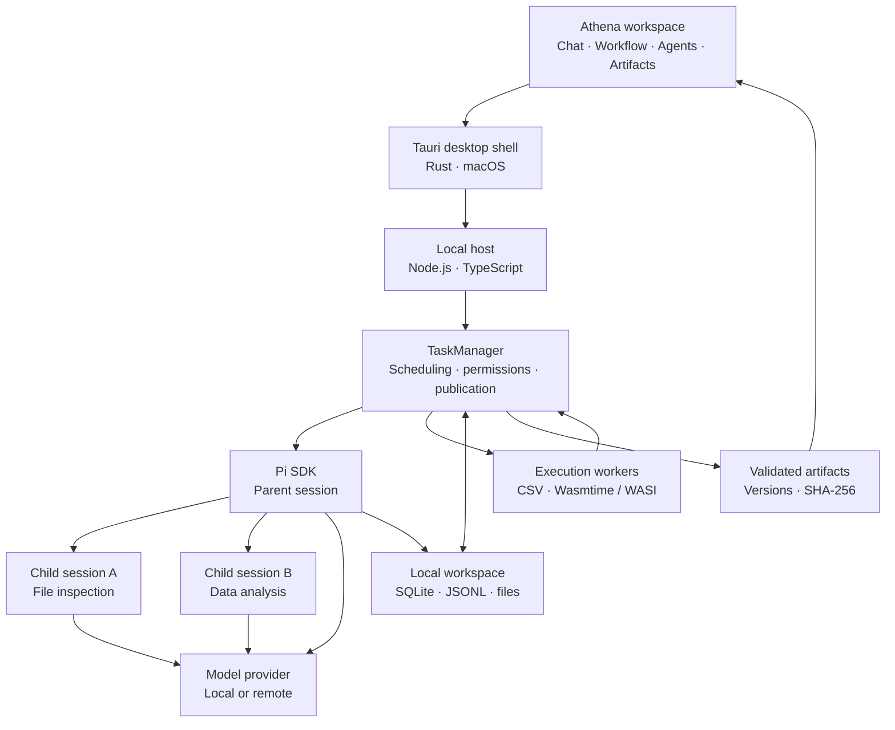

<div align="center">
  <picture>
    <source media="(prefers-color-scheme: dark)" srcset="assets/icon-dark.png">
    
  </picture>

  <h1>Athena</h1>
  <p><strong>AI 연구를 위한 로컬 우선 워크스페이스.</strong></p>
  <p>에이전트로 연구하고, 실행을 확인하며, 근거를 보존하세요.</p>

  <a href="https://github.com/yanaire/athena/actions/workflows/verify.yml"></a>
  
  

  <p>
    <a href="README.md">English</a> · <strong>한국어</strong> · <a href="README.ja.md">日本語</a> · <a href="README.zh-CN.md">简体中文</a> · <a href="README.zh-TW.md">繁體中文</a> · <a href="README.es.md">Español</a> · <a href="README.fr.md">Français</a> · <a href="README.de.md">Deutsch</a> · <a href="README.pt-BR.md">Português (Brasil)</a>
  </p>
</div>

> **현재 상태(2026-11-25):** 검토한 Apple Silicon Mac용 통합 후보에는 MCP, 연구 확장 기능, Workflow DAG 소스가 포함되어 있습니다.
> 아래의 기준선 설명과 검증 기록은 이전 버전의 이력을 보존한 것으로, 실제 Mac과 실제 계정을 사용한 최종 인수 검증은 아직 완료되지 않았으며, 현재 통합 범위는 [영문 README](README.md)와 [통합 검토 기록](docs/validation/2026-11-25-open-pr-integration-review.md)을 참고하세요.

> [!IMPORTANT]
> **소스 프리뷰이며 정식 공개 릴리스가 아닙니다.** Athena 자체 코드에 Apache-2.0을 선택했지만, 제3자 고지, UI·에셋 권리 및 Git 이력 공개 적합성 검토가 남아 있습니다. 저장소가 공개 상태라고 이 의무가 해결된 것은 아닙니다. 검토 완료 전에는 소스 후보나 앱을 재배포하지 마세요. [릴리스 상태](docs/oss-preview-status.md), [제3자 고지](THIRD_PARTY_NOTICES.md), [알려진 제한](docs/known-limitations.md)을 참조하세요. 정식 서명·공증 설치 파일이나 공개 DMG는 없습니다.

## 프로젝트 소개

Athena는 연구 지향 AI 에이전트 하네스이자 데스크톱 워크스페이스입니다. AI 답변 자체에 그치지 않고 대화, 위임된 작업, 파일 검사, 분석, 추적 가능한 결과물을 하나의 로컬 공간에서 연결합니다.

**세 가지 설계 원칙**

- **오케스트레이션:** 상위 에이전트가 독립적인 작업을 하위 세션에 위임하고 결과를 통합합니다.
- **추적 가능성:** 실행 이벤트, 작업 관계, 원본 파일과 검증된 결과물을 확인합니다.
- **로컬 제어:** 프로젝트 파일과 대화 기록을 자신의 컴퓨터에 보관하고 지원되는 로컬·원격 모델을 선택합니다.

로컬 우선은 워크스페이스와 실행 환경을 의미하며 모델 추론이나 모든 데이터 처리의 오프라인 동작을 보장하지는 않습니다. 원격 모델 제공자는 추론에 필요한 입력을 수신합니다.

## 주요 기능

병합되지 않은 기능 브랜치가 아닌 현재 `main` 기준입니다.

| 영역 | 현재 지원 기능 |
| :--- | :--- |
| 연구 워크스페이스 | 프로젝트, 연구 대화, 첨부, 스트리밍 응답, 기록 보존 |
| 멀티에이전트 | 상위·하위 Pi 세션, 작업 위임, 동시 실행·깊이 제한, 취소, 워크플로우 검사 |
| 연구 파일 | 범위 제한 파일 읽기, 내장 CSV 통계, 입력 버전·SHA-256 증빙을 가진 호스트 검증 결과물 다운로드 |
| 오프라인 분석 | Docker 없이 Wasmtime에서 Python(CPython/WASI) 및 JavaScript(QuickJS-ng) 선택 실행 |
| 모델 연결 | OpenAI·Anthropic API 인증 정보, 호환 엔드포인트, 모델 프로필 저장 및 연결 검증 |
| 데스크톱 | Tauri 및 내장 Node 사이드카 기반 Apple Silicon macOS 소스 빌드 |
| 실행 가시성 | 실제 호스트 기록 기반 Workflow, Agents, Execution, Artifacts 화면 |

**개발 중 / 현재 기준 미포함:** MCP 통합은 별도로 개발 중입니다. 영속 지식 라이브러리, 버전 관리 PDF·원고·리뷰 워크플로우, 고급 Pi 플러그인, 승인 및 자동 재시도는 현재 기준에 구현되지 않았습니다. [계약상 미구현 기능](athena-backend-handoff/CONTRACT-GAPS.md)을 참조하세요.

## 아키텍처



브라우저 개발 UI도 로컬 Node 호스트에 직접 연결할 수 있습니다. TaskManager는 스케줄링, 파일 권한, 실행 상태, 결과물 게시를 담당하고 공식 Pi SDK는 독립적인 상위·하위 모델 세션과 JSONL 이력을 담당합니다. 모델 선택은 해당 실행과 하위 작업 전체에서 고정됩니다.

| 계층 | 기술 |
| :--- | :--- |
| 데스크톱 | Rust · Tauri 2 · WKWebView |
| 에이전트 호스트 | Node.js 24 · TypeScript · Pi SDK 1.5.2 |
| 영속 저장 | SQLite 메타데이터 · JSONL 세션 이력 · 프로젝트 파일 |
| 분석 | Rust · Wasmtime · CPython/WASI · QuickJS-ng |
| UI 통신 | 로컬 HTTP RPC · Server-Sent Events |
| 검증 | GitHub Actions · TypeScript · Node 테스트 러너 · Rust 테스트 · Gitleaks |

[아키텍처 가이드](docs/architecture.md) · [브라우저/호스트 통신 계약](athena-backend-handoff/athena-codex-ui/integrations/host-wire.d.ts) · [샌드박스 경계](docs/sandbox-security.md)

## 빠른 시작

**사용이 허가된 로컬 소스 체크아웃**에서 실행하세요. 이 프리뷰에는 정식 설치 파일이 없습니다.

### 1. 브라우저 개발

**요구사항:** Node.js 24(검증 버전 24.22.3), npm, 스트리밍 및 도구 호출을 지원하는 OpenAI 호환 모델 서버. 실제 서버의 엔드포인트와 모델 ID를 사용하세요.

```sh
npm ci --ignore-scripts --no-audit --no-fund

export ATHENA_ENDPOINT=http://127.0.0.1:8080/v1
export ATHENA_MODEL=athena-local

# If required, set ATHENA_API_KEY privately in the host environment.
npm start
```

**http://127.0.0.1:4317**에서 **Settings → Models**로 이동하여 연결을 검증하고 저장하세요. **Add project**로 프로젝트를 만든 뒤 **New research**로 대화를 생성합니다.

생성된 `athena-preview.html`을 파일로 직접 열면 독립 데모일 뿐 연결된 연구 실행 환경이 아닙니다. OmO 설치, 로그인, 세션은 필요하지 않습니다.

### 2. macOS 데스크톱 소스 빌드

대상: **Apple Silicon · macOS 13.5 이상**. [개발 가이드](docs/development.md)의 고정된 도구 버전과 필수 구성 요소를 설치하세요.

```sh
npm ci --ignore-scripts --no-audit --no-fund
npm run analysis:prepare
npm run desktop:build
```

출력:

```text
src-tauri/target/aarch64-apple-darwin/release/bundle/macos/Athena.app
```

앱에는 Node 런타임, Pi SDK, 분석 인터프리터 두 개가 포함되며 모델 가중치나 인증 정보는 포함되지 않습니다. 개발 빌드는 Developer ID 서명 또는 공증을 받지 않았습니다. 설치 검증을 위해 Gatekeeper를 우회하지 마세요.

[설치 상세](docs/installation.md) · [모델 제공자](docs/model-providers.md)

<details>
<summary><strong>개인용 로컬 ChatGPT 빌드</strong></summary>

표준 데스크톱 빌드와 브라우저 호스트는 ChatGPT 플랜 로그인이 비활성화되어 있습니다. Mac 개인 사용을 위한 별도 개발 빌드로 공식 로그인 경로를 활성화할 수 있습니다.

```sh
npm run desktop:build:local-chatgpt
```

동일한 번들 출력 경로에 다른 앱 ID를 사용하므로 전환하기 전에 기존 번들을 복사하세요. 계정 및 워크스페이스 자격은 OpenAI가 판단하며 개인 로컬 사용 승인은 원격·상업적 배포 승인이 아닙니다.

[연결 방법](docs/installation.md#personal-local-build-with-chatgpt) · [검증 기록](docs/m42/siwc.md)

</details>

## 연구 예시

포함된 합성 데이터 [measurements.csv](docs/measurements.csv)로 에이전트부터 결과물까지의 흐름을 확인할 수 있습니다.

1. 연구 대화를 만들고 CSV를 첨부합니다.
2. 상위 에이전트에게 두 작업을 위임하고 모두 시작한 후 결과를 기다리라고 요청합니다.
3. **Workflow**에서 하위 작업을 확인하고 **Artifacts**에서 검증된 결과를 다운로드합니다.

**예시 프롬프트**

> 두 작업을 위임해 줘. 첫 하위 에이전트는 `read`로 행 수, 결측값, 단위를 확인하고, 둘째는 `calculate_csv`로 `measurement_mV`를 분석하여 `statistics.json`을 만들어 줘. 두 작업을 모두 시작하고 결과를 기다린 다음 평균과 실제 결과 파일 링크를 알려 줘.

파일 읽기와 내장 CSV 작업자는 선택형 분석 런타임 없이도 동작합니다. [M2 인수 기록](docs/M2-ACCEPTANCE.md) · [프로세스 제한](docs/M2-PROCESSES.md)

## 보안 및 실행 경계

Athena는 신뢰할 수 있는 컴퓨터의 단일 사용자를 대상으로 합니다. 호스트는 루프백에만 바인딩되므로 외부 인터페이스나 공유 프록시에 노출하지 마세요. 브라우저 개발 호스트에는 데스크톱 세션 인증 경계가 없습니다.

- 기본 브라우저 워크스페이스는 `~/.athena/workspace`이며 `ATHENA_DATA_DIR`, `ATHENA_PORT`를 변경할 수 있습니다. 재시작 시 미완료 작업을 자동 실행하지 않습니다.
- 로컬 대화, 입력, 결과물은 인증 저장소로 암호화되지 않습니다. 같은 OS 사용자로 실행되는 프로그램이 접근할 수 있습니다.
- macOS 인증 정보는 `~/Library/Application Support/Athena/auth/credentials.v2.json`에 평문으로 저장되며 디렉터리 권한은 `0700`, 파일은 `0600`입니다. 같은 OS 사용자, 관리자, 백업으로부터 보호하지 못합니다.
- 일반 실행은 Keychain 접근을 요청하지 않습니다. **Settings → Models → Approve import from Keychain**에서 선택적으로 이전 저장소를 가져오며 거절하면 기존 저장소가 유지됩니다.
- 프로젝트별 오프라인 분석은 기본 비활성화이며 **Settings → Agents & execution**에서 활성화합니다. Python은 WASI 표준 라이브러리를 사용하고 JavaScript의 기존 `language: "node"` 값은 Node.js나 npm이 아닌 QuickJS를 뜻합니다. 샌드박스와 감시기는 완전한 OS 격리가 아닙니다.

[개인정보](PRIVACY.md) · [보안 정책](SECURITY.md) · [인증 저장](docs/keychain-security.md) · [분석 보안](docs/sandbox-security.md)

<details>
<summary><strong>실행 제한 및 호스트 계약</strong></summary>

| 환경 변수 | 기본값 | 의미 |
| :--- | ---: | :--- |
| `ATHENA_MODEL_CONCURRENCY` | 2 | 1–64; 대기 중인 상위 작업은 하위 작업에 모델 슬롯 양보 |
| `ATHENA_PROCESS_CONCURRENCY` | 1 | 1–4; 별도 프로세스 한도 |
| `ATHENA_MAX_CHILDREN` | 8 | 0–128; 상위 실행당 직속 하위 작업 수 |
| `ATHENA_MAX_DEPTH` | 1 | 0은 위임 비활성화, 1은 직속 하위 작업만 허용 |

브라우저는 `GET /api/bootstrap`, `POST /api/rpc`, `GET /api/events`를 사용합니다. 모델 검증, 설정 보존, 생성·도구 실행 성공은 별개입니다. 브라우저 저장소는 실행 기록의 정본이 아닙니다. TaskManager는 소유권, 파일 바이트 및 입력 버전 검증 후에만 결과물을 게시합니다.

[통신 타입](athena-backend-handoff/athena-codex-ui/integrations/host-wire.d.ts) · [M2 프로세스](docs/M2-PROCESSES.md)

</details>

## 개발 및 검증

```sh
npm run check
npm run analysis:prepare
npm test
python3 athena-backend-handoff/athena-codex-ui/build.py
```

[Verify Athena 워크플로우](.github/workflows/verify.yml)는 Gitleaks Git 이력 검사, 타입·UI 계약 검증, 호스트·통제 제공자 테스트, 운영 npm 의존성 및 선언 라이선스 감사, Apple Silicon 및 Windows x64 앱 빌드·설치 검증을 수행합니다. Intel Mac은 수동 소스 빌드를 사용할 수 있습니다.

별도 실모델 인수 시험은 앞서 설정한 모델과 엔드포인트를 사용합니다.

```sh
node scripts/live-acceptance.mjs
```

실제 모델 토큰과 임시 워크스페이스를 사용하여 파일 읽기, 모델 출력, 스트리밍 이벤트, ID, 재시작 후 기록 보존을 검증합니다. 통제 제공자 테스트는 실모델 검증을 대신하지 않으며 CI 성공이 공개 릴리스 승인을 의미하지는 않습니다.

[개발 가이드](docs/development.md) · [M1 인수 기록](docs/M1-ACCEPTANCE.md) · [M2 인수 기록](docs/M2-ACCEPTANCE.md)

## 저장소 구조

```text
athena/
├── runtime/                 # Local agent host and TaskManager
├── src-tauri/               # Rust/Tauri desktop shell
├── sandbox/                 # Rust/WASI analysis helper
├── athena-backend-handoff/  # UI, integration contracts and QA
├── assets/                  # Athena icon variants
├── scripts/                 # Build and acceptance tooling
├── tests/                   # Host and provider regression tests
├── docs/                    # Architecture, security, verification
└── .github/workflows/       # CI verification
```

## 문서

| 주제 | 가이드 |
| :--- | :--- |
| 시작하기 | [설치](docs/installation.md) · [모델 제공자](docs/model-providers.md) |
| 내부 구조 | [아키텍처](docs/architecture.md) · [UI 통합](athena-backend-handoff/START-HERE.md) |
| 개발 | [빌드와 테스트](docs/development.md) · [인수 계약](athena-backend-handoff/ACCEPTANCE.md) |
| 안전 | [개인정보](PRIVACY.md) · [보안](SECURITY.md) · [샌드박스](docs/sandbox-security.md) |
| 릴리스 | [프리뷰 상태](docs/oss-preview-status.md) · [제한](docs/known-limitations.md) · [체크리스트](docs/release-checklist.md) · [M4.2 릴리스 노트](docs/m42/release-notes.md) |
| 정책 | [기여](CONTRIBUTING.md) · [행동 강령](CODE_OF_CONDUCT.md) · [제3자 고지](THIRD_PARTY_NOTICES.md) |

## 라이선스 및 기여 상태

Athena 자체 코드의 선택 라이선스는 [Apache License 2.0](LICENSE)입니다. 제3자 자료에는 각각의 조건이 적용됩니다. [재배포 검토](THIRD_PARTY_NOTICES.md)와 [공개 릴리스 조건](docs/oss-preview-status.md)이 우선하며 이 README는 확대 배포나 공개 기여를 승인하지 않습니다. 기존 [기여 정책](CONTRIBUTING.md)을 따르세요.

보안 문제는 [SECURITY.md](SECURITY.md)를 따르세요. 비공개 취약점 신고는 활성화와 검증 후에만 의존할 수 있습니다. 취약점, 토큰, 개인정보, 연구 파일을 공개 이슈에 게시하지 마세요.

---

<div align="center">
  <sub>ATHENA · LOCAL RESEARCH WORKSPACE</sub>
</div>
