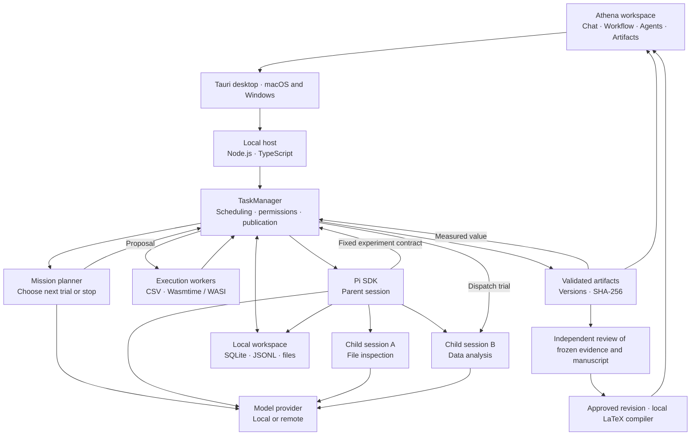

<div align="center">
  <picture>
    <source media="(prefers-color-scheme: dark)" srcset="assets/icon-dark.png">
    
  </picture>

  <h1>Athena</h1>
  <p><strong>A local-first workspace for AI-assisted research.</strong></p>
  <p>Research with agents. Inspect their work. Keep the evidence.</p>

  <a href="https://github.com/yanaire/athena/actions/workflows/verify.yml"></a>
  
  
  

  <p>
    <strong>English</strong> · <a href="README.ko.md">한국어</a> · <a href="README.ja.md">日本語</a> · <a href="README.zh-CN.md">简体中文</a> · <a href="README.zh-TW.md">繁體中文</a> · <a href="README.es.md">Español</a> · <a href="README.fr.md">Français</a> · <a href="README.de.md">Deutsch</a> · <a href="README.pt-BR.md">Português (Brasil)</a>
  </p>

  <p>
    <a href="#overview">Overview</a> ·
    <a href="#capabilities">Capabilities</a> ·
    <a href="#architecture">Architecture</a> ·
    <a href="#quick-start">Quick start</a> ·
    <a href="#documentation">Documentation</a>
  </p>
</div>

> [!IMPORTANT]
> **Source preview, not a public release.** Athena-owned code has a selected Apache-2.0 license, but third-party notices, UI/asset rights and history clearance remain subject to review. The repository's public visibility does not resolve these obligations. Do not redistribute this source candidate or its app until the outstanding gates have been cleared. See [release status](docs/oss-preview-status.md), [third-party notices](THIRD_PARTY_NOTICES.md) and [known limitations](docs/known-limitations.md). No official signed/notarized installer or public DMG is available.

## Overview

Athena is a local-first workspace for research with AI agents. It connects conversations, delegated tasks, file inspection and analysis, while keeping a traceable record of the work and its results.

**Three design principles**

- **Orchestration:** a parent agent delegates independent work to child sessions and combines their results.
- **Traceability:** inspect execution events, task relationships, source files and validated output artifacts.
- **Local control:** keep project files and conversation history on your machine; choose a supported local or remote model provider.

Local-first refers to the workspace and execution environment, not a guarantee that model inference or all data processing stays offline. Remote model providers receive the inputs needed for inference.

## Capabilities

The following describes the desktop source candidate. The
[2026-11-25 integration review](docs/validation/2026-11-25-open-pr-integration-review.md)
records the baseline integration. Use the candidate's CI for native installer
verification. ChatGPT-account acceptance is a separate test.

| Area | Current capability |
| :--- | :--- |
| Research workspace | Projects, research conversations, attachments, streaming responses and persisted history |
| Multi-agent execution | Parent/child Pi sessions, task delegation, concurrency and depth limits, cancellation, and manual retry that preserves completed work |
| Research files | Scoped file reads, registered CSV statistics and RC calculations; host-validated downloadable artifacts with input versions and SHA-256 receipts |
| Offline analysis | Opt-in Python (CPython/WASI) and JavaScript (QuickJS-ng) execution through Wasmtime, without Docker |
| Model connections | Supported OpenAI and Anthropic API credentials, compatible endpoints, saved model profiles and connection verification |
| Desktop | Native macOS arm64/x64 and Windows x64 builds using Tauri and a bundled Node sidecar |
| Execution visibility | Recorded Workflow DAG, task and agent history, and Artifacts views backed by actual host records |
| Research records | Mission plans, exact input/result evidence, separately assigned reviewers, reusable observations and verified methods |
| Manuscripts | In a research project, one chat request links a planned experiment and independently reviewed manuscript to a compiled LaTeX PDF. The side panel shows saved progress, draft sections and downloads. |
| Extensions | Twelve version-pinned research skills and explicitly approved external MCP connections |

**Remaining scope:** The runtime Browser, Device, Files and Diff panels do not yet
provide their broader automation services. Journal submission, arbitrary executable plugins, scheduled research wake-ups and automatic retries
remain outside the implemented scope. See the [UI capability audit](docs/ui-capability-audit.md)
and [research workflow contract](docs/research-workflow.md).

### Research extensions

The integrated source extends the CSV/RC workflow with project-owned declarative
plugins, explicitly approved external
MCP connections, 12 versioned research skills and an evidence-based research
board. Acceptance of the exact app build on a Mac with the user's actual model
account remains a separate, unfinished verification step.

- **Settings → Tools & plugins:** import or update a JSON package, inspect its
  endpoints and allowed tools, check each MCP connection, then enable the package.
  Skills can be selected individually. Changes apply to new runs; existing runs
  retain their admitted versions and credentials. In chat, type `$`, select a
  project skill with Enter or Tab and send the request. See the
  [CadQuery STEP experiment](examples/cad-spacer/) for a runnable program plugin.
- **Workflow → Research board:** inspect the research plan, actual input/result
  evidence, independent reviewer receipts and reusable methods. Model review,
  independent reproduction and human-confirmed conventions remain distinct.
- **Artifacts:** open and download the same validated file produced by the
  built-in CSV/RC tools or an approved external MCP. The browser does not perform
  the engineering calculation again.

External connections currently support bounded MCP Streamable HTTP with text
and structured JSON results, plus optional dedicated bearer credentials. Plugin
packages contain guidance and connection declarations; they do not execute
installation scripts or launch arbitrary programs. This is an Athena research
workflow inspired by Hyra 2.0, not an imported Hyra runtime.

[Plugin, skill and external MCP contract](docs/ecosystem/RUNTIME.md) ·
[Research workflow and Books](docs/research-workflow.md) ·
[Candidate acceptance and Mac handoff](docs/ecosystem/ACCEPTANCE.md)

### Workflow and desktop platforms

The source includes the recorded Workflow DAG and reviewed chat fixes. CI verifies
the Apple Silicon macOS app and the Windows x64 NSIS installer. Intel Macs retain
a manual source-build target. `npm run desktop:build` selects the native target. See
the [installation guide](docs/installation.md) and [Korean installation guide](docs/installation.ko.md)
for prerequisites and explicit target commands.

The current commit's CI result records automated verification. Signed releases
and real-account acceptance remain separate. See the [UI capability audit](docs/ui-capability-audit.md)
for Browser, Device, Files and Diff features that are still unavailable.

## Architecture



The browser-development UI can also connect directly to the local Node host. TaskManager owns scheduling, file grants, run state and artifact publication; the official Pi SDK owns the independent parent/child model sessions and their JSONL histories. Settings → Models & connections can assign a saved model and reasoning level to each worker role. TaskManager freezes those choices with the coordinator's model for each run.

| Layer | Technology |
| :--- | :--- |
| Desktop | Rust · Tauri 2 · WKWebView on macOS · WebView2 on Windows |
| Agent host | Node.js 24 · TypeScript · Pi SDK 1.6.0 |
| Persistence | SQLite metadata · JSONL session history · project files |
| Analysis | Rust · Wasmtime · CPython/WASI · QuickJS-ng |
| UI transport | Local HTTP RPC · Server-Sent Events |
| Verification | GitHub Actions · TypeScript · Node test runner · Rust tests · Gitleaks |

[Architecture guide](docs/architecture.md) · [Browser/host wire contract](athena-backend-handoff/athena-codex-ui/integrations/host-wire.d.ts) · [Sandbox boundary](docs/sandbox-security.md)

## Quick start

Run these commands from the root of an **authorized local source checkout**. The source preview has no official installers or public release downloads.

### 1. Browser development

The browser workspace runs on Linux, macOS and Windows x64. Linux supports browser development and analysis tests. A native Linux desktop build is unavailable. Use Node.js 24.22.3, npm and an OpenAI-compatible model server that supports streaming and tool calls. Substitute your server's endpoint and model identifier. Use this setup on Linux and macOS.

```sh
npm ci --ignore-scripts --no-audit --no-fund

export ATHENA_ENDPOINT=http://127.0.0.1:8080/v1
export ATHENA_MODEL=athena-local

# If required, set ATHENA_API_KEY privately in the host environment.
npm start
```

On Windows, install .NET Framework 4.8 or later so `npm start` can prepare the Windows permission helper. Set the same values in PowerShell before starting the host.

```powershell
npm ci --ignore-scripts --no-audit --no-fund
$env:ATHENA_ENDPOINT = 'http://127.0.0.1:8080/v1'
$env:ATHENA_MODEL = 'athena-local'
npm start
```

Open **http://127.0.0.1:4317**. In **Settings → Models**, verify and save the connection. Create a project with **Add project**, then create a conversation with **New research**.

The generated `athena-preview.html` opened directly as a file is a standalone demo, not a connected research runtime. No OmO installation, login or session is required.

### 2. macOS desktop source build

Build on an Apple Silicon or Intel Mac running macOS 13.5 or later. Install native Node.js 24.22.3, Rust 1.99.1, Python 3, Xcode Command Line Tools, `curl`, `tar` and `unzip`. Use the `aarch64-apple-darwin` Rust target on Apple Silicon or `x86_64-apple-darwin` on Intel. See the [development guide](docs/development.md) for details.

```sh
npm ci --ignore-scripts --no-audit --no-fund
python3 athena-backend-handoff/athena-codex-ui/build.py
npm run analysis:prepare
```

Run the native build command for your Mac.

| Target | Final build command | App output |
| --- | --- | --- |
| Apple Silicon | `npm run desktop:build` | `src-tauri/target/aarch64-apple-darwin/release/bundle/macos/Athena.app` |
| Intel | `npm run desktop:build:mac-intel` | `src-tauri/target/x86_64-apple-darwin/release/bundle/macos/Athena.app` |

Copy the complete `Athena.app` to Applications and open it. The developer build bundles the Node runtime, Pi SDK and two analysis interpreters. Set up your model and credentials separately. The app is ad hoc signed. Developer ID signing and notarization are release steps. Do not bypass Gatekeeper to claim installation acceptance.

<details>
<summary><strong>Personal local ChatGPT build</strong></summary>

ChatGPT plan sign-in is disabled in the standard desktop build and browser host. For personal use on the Mac, an alternative developer build can enable the official sign-in route:

```sh
npm run desktop:build:local-chatgpt
```

This uses the same bundle output path with a different app identifier. Copy the existing bundle before switching builds. Account and workspace eligibility are determined by OpenAI; local personal authorization does not imply approval for a remote or commercial deployment.

[Connection instructions](docs/installation.md#personal-local-build-with-chatgpt) · [Verification record](docs/m42/siwc.md)

</details>

### 3. Windows x64 desktop source build

Build on Windows 10 or 11 x64. Install native x64 Node.js 24.22.3, Rust 1.99.1 with the `x86_64-pc-windows-msvc` target, Python 3, Visual Studio Build Tools with **Desktop development with C++**, the Windows SDK, .NET Framework 4.8 or later, WebView2, Windows PowerShell, `curl.exe` and `tar.exe`. See the [development guide](docs/development.md) for details. Windows ARM64 and 32-bit Windows are unsupported. Run the commands in Developer PowerShell for Visual Studio.

```powershell
npm ci --ignore-scripts --no-audit --no-fund
python athena-backend-handoff/athena-codex-ui/build.py
npm run analysis:prepare
npm run desktop:build:windows
```

Open the generated `*-setup.exe` in `src-tauri/target/x86_64-pc-windows-msvc/release/bundle/nsis/` and follow the installer. It installs Athena for the current user and checks for .NET Framework 4.8 or later. If WebView2 is missing or below 101.0.1210.39, the installer needs internet access to install or update it. The developer installer is unsigned.

See [installation details](docs/installation.md) and [model providers](docs/model-providers.md).

## Research example

Use the included synthetic [measurements.csv](docs/measurements.csv) to see the agent-to-artifact workflow.

1. Create a research conversation and attach the CSV.
2. Ask the parent to delegate two tasks, start both and wait for their results.
3. Inspect the child tasks in **Workflow** and download the verified output from **Artifacts**.

**Example prompt**

> Delegate two tasks. Ask the first child to use `read` to check the row count, missing values and units. Ask the second to use `calculate_csv` on `measurement_mV` and produce `statistics.json`. Start both, wait for their results, then report the mean and the actual result-file link.

File reading and the built-in CSV worker do not require the optional analysis runtime. See [M2 acceptance](docs/M2-ACCEPTANCE.md) and [process limits](docs/M2-PROCESSES.md).

## Security and execution boundaries

Athena is intended for a single user on a trusted machine. The host binds to loopback; do not expose it through an external interface or shared proxy. The browser development host is not protected by the desktop's session gate.

- The default browser workspace is `~/.athena/workspace`; `ATHENA_DATA_DIR` and `ATHENA_PORT` are configurable. Restarting does not automatically rerun unfinished work.
- Local conversations, inputs and artifacts are not encrypted by the credential store. Programs running as your OS user may access these files.
- macOS credentials are stored in `~/Library/Application Support/Athena/auth/credentials.v2.json` as plaintext with directory mode `0700` and file mode `0600`. These permissions do not protect against the same OS user, privileged administrators or backups.
- Normal startup does not request Keychain access. The optional **Settings → Models → Approve import from Keychain** route imports an older store; declining leaves it untouched.
- Offline analysis is disabled by default per project. Enable it in **Settings → Agents & execution**. Python uses the WASI standard library; the legacy JavaScript `language: "node"` value selects QuickJS, not Node.js or npm. The sandbox and watchdog are not complete OS isolation.

[Privacy](PRIVACY.md) · [Security policy](SECURITY.md) · [Credential storage](docs/keychain-security.md) · [Analysis security](docs/sandbox-security.md)

<details>
<summary><strong>Runtime limits and host contract</strong></summary>

| Environment variable | Default | Meaning |
| :--- | ---: | :--- |
| `ATHENA_MODEL_CONCURRENCY` | 2 | 1–64; waiting parents yield model slots to children |
| `ATHENA_PROCESS_CONCURRENCY` | 1 | 1–4; separate process limit |
| `ATHENA_MAX_CHILDREN` | 8 | 0–128; direct children per parent execution |
| `ATHENA_MAX_DEPTH` | 1 | 0 disables delegation; 1 allows direct children only |

The browser uses `GET /api/bootstrap`, `POST /api/rpc` and `GET /api/events`. Model verification, configuration persistence and successful generation/tool execution are distinct events. Browser storage is not the source of truth for run history. TaskManager publishes artifacts only after validating ownership, file bytes and input versions.

[Wire types](athena-backend-handoff/athena-codex-ui/integrations/host-wire.d.ts) · [M2 processes](docs/M2-PROCESSES.md)

</details>

## Development and verification

```sh
npm run check
npm run analysis:prepare
npm test
python3 athena-backend-handoff/athena-codex-ui/build.py
```

The [Verify Athena workflow](.github/workflows/verify.yml) runs `history-secrets`, `apple-silicon`, `browser-chat` and `desktop-windows-x64`. It runs the native host suites, starts apps installed from the Apple Silicon DMG and Windows x64 NSIS installer, and exercises chat and workflow in Chromium with synthetic inputs. These four checks are required on `main`.

For a separate live-model acceptance run, configure the endpoint and model above:

```sh
node scripts/live-acceptance.mjs
```

This uses real model tokens and a temporary workspace. It checks actual file reads, model output, streamed events, IDs and persisted history after restart. Controlled-provider tests are not a substitute for live-model acceptance, and CI success does not establish public-release clearance.

[Development guide](docs/development.md) · [M1 acceptance](docs/M1-ACCEPTANCE.md) · [M2 acceptance](docs/M2-ACCEPTANCE.md)

## Repository layout

```text
athena/
├── runtime/                 # Local agent host and TaskManager
├── src-tauri/               # Rust/Tauri desktop shell
├── sandbox/                 # Rust/WASI analysis helper
├── athena-backend-handoff/  # UI, integration contracts and QA
├── assets/                  # Athena icon variants
├── scripts/                 # Build and acceptance tooling
├── tests/                   # Host and provider regression tests
├── docs/                    # Architecture, security, verification
└── .github/workflows/       # CI verification
```

## Documentation

| Topic | Guide |
| :--- | :--- |
| Getting started | [Installation](docs/installation.md) · [Model providers](docs/model-providers.md) |
| Internals | [Architecture](docs/architecture.md) · [UI integration](athena-backend-handoff/START-HERE.md) |
| Research extensions candidate | [Runtime contract](docs/ecosystem/RUNTIME.md) · [Research workflow](docs/research-workflow.md) · [Acceptance](docs/ecosystem/ACCEPTANCE.md) |
| Development | [Build and test](docs/development.md) · [Acceptance contract](athena-backend-handoff/ACCEPTANCE.md) |
| Safety | [Privacy](PRIVACY.md) · [Security](SECURITY.md) · [Sandbox](docs/sandbox-security.md) |
| Release | [Preview status](docs/oss-preview-status.md) · [Known limitations](docs/known-limitations.md) · [Release checklist](docs/release-checklist.md) · [M4.2 release notes](docs/m42/release-notes.md) |
| Project policies | [Contributing](CONTRIBUTING.md) · [Code of conduct](CODE_OF_CONDUCT.md) · [Third-party notices](THIRD_PARTY_NOTICES.md) |

## License and contribution status

The selected license for Athena-owned code is [Apache License 2.0](LICENSE). Third-party materials retain their own terms. The [redistribution review](THIRD_PARTY_NOTICES.md) and [public-release gates](docs/oss-preview-status.md) remain controlling; this README does not authorize a wider release or open contributions. Follow the existing [contribution policy](CONTRIBUTING.md).

For security issues, follow [SECURITY.md](SECURITY.md). Private reporting must be enabled and verified before it is relied upon. Do not post vulnerabilities, tokens, personal data or research files in public issues.

---

<div align="center">
  <sub>ATHENA · LOCAL RESEARCH WORKSPACE</sub>
</div>
